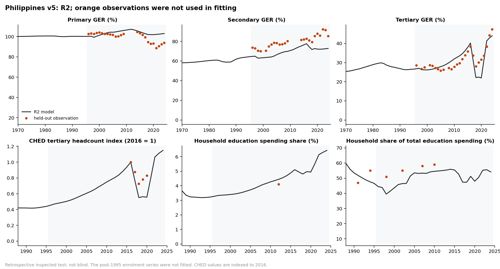
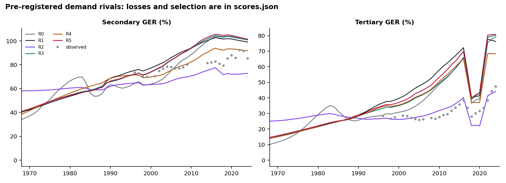

# The Limits of Demand-Side Explanations of Educational Expansion

## Rival Models, Historical Accounting, and the Philippine K-12 Transition

**Trey Menefee**  
*Independent researcher*  
*November 2026 · Results-led working paper*

## Abstract

Why does educational participation continue to expand when the wage premium to the next credential falls? This paper turns that familiar theoretical question into an explicit comparison of six demand-side models for the Philippines. The models share cohort accounting and observed policy inputs but differ in whether participation responds to income, earnings returns, positional feedback, formal-economy thresholds, or saturation-dependent costs. Parameters are fitted to registered pre-1996 enrolment observations and declared household-spending targets, then scored on later observations. The test is retrospective and inspected, not blind. Under the registered three-GER selection rule, **R2** has the lowest rival RMSE. Its RMSE of 7.458 percentage points is worse than persistence (6.600); the best naive benchmark is therefore not beaten (trend: 11.794). Moreover, the selected specification's human-capital coefficient is -6.000, at its lower bound. The statistical selection therefore cannot be read as evidence for a positive earnings-return mechanism. The full positional-relational specification does not win, and the separating observations do not provide a consistent mechanism ranking. The paper therefore makes a deliberately limited contribution: it shows which theoretical ambitions the present evidence cannot sustain, while supplying a reproducible accounting and model-comparison framework for stronger tests. Status: **not calibrated**.

**Keywords:** educational demand; massification; Philippines; K-12; model comparison; human capital; positional competition; credential thresholds; reproducibility

## 1. A different question

This is not a general theory of massification. It asks a narrower empirical question: when several demand-side explanations are required to reproduce the same historical observations, which survives comparison with its rivals and with naive benchmarks? The distinction matters. A model can reproduce a trend for the wrong reason, a theoretically preferred mechanism can lose to a simpler alternative, and the best member of a model set can still lose to carrying the last observation forward.

The Philippine case is useful because it combines long enrolment series, uneven economic returns, household financing observations, and a dated structural break. The 2013 K-12 reform added senior secondary years; the first two cohorts did not feed directly into tertiary education, producing a sharp but temporary tertiary headcount contraction. The college premium used here falls from 0.88 to 0.59 log points between 2013 and 2024, while tertiary gross enrolment rises from 31.870% to 47.413%. These observations discipline the models but do not, by themselves, identify causation.

The analysis is organised around losses rather than theoretical preference. The preferred rival is selected only by the registered mean RMSE over primary, secondary, and tertiary GER in held-out years. Naive persistence and linear-trend rules are reported alongside every structural model. The result is a test of the implementations and data used here, not a once-and-for-all test of every human-capital, positional, or relational theory.

## 2. A common accounting core with rival demand signals

All six rivals use the same cohort engine. Children progress by age, grade, income decile, and sector; repetition, completion, deferred tertiary entry, policy costs, and cycle changes are explicit. This common structure prevents differences in bookkeeping from masquerading as differences in behaviour. The demand signal for level $L$, decile $d$, and year $y$ is

$$
\begin{aligned}
U_{Ldy} ={}& \alpha_L + b_h p_{Ly} + b_p S_{L,y-1} + b_r R_{Ly}
 + \eta_x \log(I_{dy}/\bar I_y)
 - \kappa A_{Ldy} \log(1+C_{Lsdy}/I_{dy}),
\end{aligned}
$$

where $p$ is the wage premium, $S$ is the previous credential stock, $R$ is the credential-threshold proxy, $I$ is decile income, and $C$ is direct plus forgone cost. Saturation-dependent affordability is $A_{Ldy}=\exp(-\lambda S_{L,y-1})$; R5 replaces $S$ with the threshold driver $R$. The rivals impose different restrictions on this common expression.

| Rival | Demand account |
|---|---|
| R0 | Earlier income-sensitive benchmark: national income, decile income, and cost |
| R1 | Full human-capital, positional, relational-threshold, and saturation-dependent-cost engine |
| R2 | Human capital only; positional, threshold, and saturation feedback removed |
| R3 | Full demand terms with constant rather than saturation-dependent cost sensitivity |
| R4 | Full engine without positional feedback |
| R5 | Cost sensitivity varies with the credential threshold rather than saturation |

The threshold driver is exogenous in these runs. Aggregate timing cannot distinguish requirements causing enrolment from enrolment causing requirements. A stronger design would need occupational requirements measured before the enrolment changes.

## 3. Registered design and evidence limits

Training uses the registered 1971–1995 enrolment series plus declared APIS and early FIES targets. Test observations include post-1995 enrolment, CHED tertiary headcounts for 2016–2020, FIES 2012, and National Transfer Account household-financing shares. The unverified FIES 2023 row is excluded. The DepEd transition observation is 1,587,416 Grade 10 completers in SY2016–17 and 1,481,103 Grade 11 entrants in SY2017–18, or 93.3%; its reference year is 2018.

For a series with $n$ scored observations, loss is

$$
\operatorname{RMSE}=\sqrt{\frac{1}{n}\sum_{i=1}^{n}(\hat y_i-y_i)^2}.
$$

GER errors are in percentage points. Lower is better. The protocol was written before the v5 fits and has no amendments. Computational continuation of an optimiser is not a change to targets, weights, or model rules. Nevertheless, the later observations had been inspected in earlier work: this is **not blind validation**.

## 4. Results: the best rival still has serious losses

The registered winner is **R2**, with three-GER held-out RMSE **7.458**. Its RMSE of 7.458 percentage points is worse than persistence (6.600); the best naive benchmark is therefore not beaten (trend: 11.794).
 Moreover, the selected specification's human-capital coefficient is -6.000, at its lower bound. The statistical selection therefore cannot be read as evidence for a positive earnings-return mechanism.

| Rival | Three-GER RMSE | RMSE minus R0 | Training cost | Evaluations | Bounds |
|---|---:|---:|---:|---:|---|
| R0 | 14.230 | 0.000 | 171.173 | 77 | nu, eta |
| R1 | 16.925 | 2.695 | 105.258 | 573 | none |
| R2 | 7.458 | -6.771 | 382.875 | 82 | eta_x, nu, b_h |
| R3 | 15.184 | 0.955 | 160.465 | 49 | none |
| R4 | 12.194 | -2.036 | 110.426 | 278 | none |
| R5 | 16.543 | 2.314 | 135.706 | 88 | none |

For reference, persistence scores 6.600 and linear trend 11.794 on the same GER rows. Training cost is not the selection criterion. A lower training cost can coexist with a worse held-out prediction, which is precisely why the two are separated.

### 4.1 The premium–participation contrast

The lowest-error rival on the paired 2013 and 2024 tertiary observations is **R2**, with RMSE 3.102 points. This is a descriptive separating test, not a causal estimate of the wage premium. The result is particularly important for interpretation: matching the direction of tertiary expansion is not sufficient to validate the mechanism that generated it.

### 4.2 Recessions and the first senior-high transition

The lowest-error recession prediction is **R3** (RMSE 0.772), using the observed years available in the registered test set. The closest Grade 10→11 prediction is **R4**, with transition-rate RMSE 0.922 points. No single mechanism sweeps these tests. Support for saturation-dependent cost sensitivity would require R1 to beat R3 both on recession behaviour and overall GER RMSE; that joint requirement is not established merely because one fit looks plausible.

### 4.3 K-12 tertiary contraction and incomplete recovery

All models reproduce a tertiary contraction around the first senior-high cohorts, but most understate the subsequent headcount recovery. The observed CHED index, with 2016 = 1, reaches 0.830 in 2020. This gap is substantive, not cosmetic: deferred entry and cohort accounting are not enough to recover the observed series under the fitted demand rules. The CHED transcription has not yet been independently rechecked against its original PDF because the source server is inaccessible; the table remains a declared QA limitation rather than a silently passed check.

### 4.4 Household financing

The models broadly reproduce the level and upward movement of the household share of total education spending, but aggregate fit again conceals errors. Financing shares are not per-student costs, and aggregate spending is not spending per pupil. These data constrain the cost scale; they do not identify why households value credentials.

## 5. Synthetic recovery and identification

The recovery exercise uses 20 synthetic replicates around the selected fit with the declared Gaussian noise design. Optimiser-cap replicates: **0**. The registered pass rule requires each relevant parameter to return within ±25% of a nonzero truth in at least 80% of replicates. Failure means **not identified** under this design, not zero effect.

| Parameter | Truth | Recovered median | 5th–95th percentile | Within ±25% | Bound hits | Status |
|---|---:|---:|---:|---:|---:|---|
| b_h | -6.000 | -6.000 | -6.000 to -4.468 | 0.95 | 15 | **identified** |
| b_p | — | — | — | — | — | not in rival |
| kappa | 1.865 | 1.707 | 0.949 to 2.464 | 0.60 | 0 | **not identified** |

Failing parameters: **kappa**. Recovery from data generated by the same model is a minimum diagnostic. It does not establish identification from the real historical series, where model error and measurement error coexist. Although `b_h` meets the numerical recovery rule, it hits a bound in 15/20 replicates. That is boundary recovery, not clean interior identification or evidence for a positive effect.

## 6. What follows—and what does not

Three conclusions are licensed. First, a common cohort-and-policy accounting structure can host sharply different demand explanations, making their comparative losses visible. Second, the present Philippine results do not justify elevating the full positional-relational engine above its rivals. Third, model selection among structural rivals is not enough: naive benchmarks, bound diagnostics, separating tests, and recovery all change the interpretation.

Three stronger claims are not licensed. The exercise does not prove that earnings returns cause participation, that positional competition drives massification, or that occupational thresholds form an exogenous relational floor. Nor does it validate the model for forecasting or policy simulation. Its status remains **not calibrated**.

The most useful next step is therefore not another narrative defence of a preferred mechanism. It is better measurement: consistent wage-premium series, original administrative headcounts, dated occupational requirements, and supply-capacity measures capable of distinguishing inaccessible seats from unwanted ones. The v6 fractional admissions work addresses the accounting side of that programme; it does not repair the demand-side identification failures reported here.

## 7. Relation to the wider research programme

The original massification manuscripts remain separate theoretical works. This paper does not recycle their argument with a new empirical appendix; it begins with comparative losses and accepts a negative result. A related credential-floor check points in the same cautious direction. In the China comparison, the observed raw change is −0.0387 and the cohort-adjusted change is −0.0531, whereas the human-capital, positional, and relational models predict positive median changes of 0.056, 0.068, and 0.078 respectively; no 10–90% interval crosses zero. Those credential-floor results must not be cited as support for the relational account.

The paper also preserves distinctions developed in Mark Bray's work: household contributions reveal the full cost of schooling rather than proving independent household demand; remedial, enrichment, and examination-preparation tutoring are not interchangeable; and sample-specific tutoring rates are not national administrative accounts. These distinctions constrain interpretation rather than supplying a decorative literature review.

## 8. Reproducibility and release status

The bundle contains the registered protocol, exact dependencies, source and output hashes, fit and scoring scripts, recovery code, tests, figures, and fresh-copy comparison. Reproduction claims should be read from `outputs/qa/fresh_copy_comparison.json` and `outputs/qa/reproducibility_inputs.json`, not from the prose alone. Atlas Worlds release remains **NOT READY** while a source or computational QA gate is open. No Hong Kong extension is part of this paper.

## Data and code availability

The accompanying archive and draft pull request contain the complete MASSENG model and final Philippine v5 outputs. `PROTOCOL_v5.md` is authoritative for the design. `outputs/PHL/v5/scores.json` is authoritative for comparative results, and the recovery JSON is authoritative for recovery diagnostics.

## References

Bray, M. (1996). *Counting the Full Cost: Parental and Community Financing of Education in East Asia*. World Bank.

Bray, M. (1999). *The Private Costs of Public Schooling: Household and Community Financing of Primary Education in Cambodia*. UNESCO-IIEP.

Bray, M., & Kwok, P. (2003). Demand for private supplementary tutoring: Conceptual considerations and socio-economic patterns in Hong Kong. *Economics of Education Review, 22*(6), 611–620.

Bray, M., Kobakhidze, M. N., Liu, J., & Zhang, W. (2016). The internal dynamics of privatised public education: Fee-charging supplementary tutoring provided by teachers in Cambodia. *International Journal of Educational Development, 49*, 291–299.

Zhan, S., Bray, M., Wang, D., Lykins, C., & Kwo, O. (2013). The effectiveness of private tutoring: Students’ perceptions in comparison with mainstream schooling in Hong Kong. *Asia Pacific Education Review, 14*, 495–509.

---

# Appendix: complete generated result tables

## PHL v5 — retrospective rival test

**Losses first. Status: not calibrated. This was a retrospective, inspected test, not a blind validation.**

The pre-registered winner is **R2**, with three-GER held-out RMSE **7.458**. R0 is **14.230**, persistence **6.600**, and linear trend **11.794**. Lower is better; selection uses the three GERs only, not training cost.

| rival | three-GER RMSE | minus R0 | persistence | trend | training cost | evaluations | at bounds |
|---|---:|---:|---:|---:|---:|---:|---|
| R0 | 14.230 | 0.000 | 6.600 | 11.794 | 171.173 | 77 | nu, eta |
| R1 | 16.925 | 2.695 | 6.600 | 11.794 | 105.258 | 573 | none |
| R2 | 7.458 | -6.771 | 6.600 | 11.794 | 382.875 | 82 | eta_x, nu, b_h |
| R3 | 15.184 | 0.955 | 6.600 | 11.794 | 160.465 | 49 | none |
| R4 | 12.194 | -2.036 | 6.600 | 11.794 | 110.426 | 278 | none |
| R5 | 16.543 | 2.314 | 6.600 | 11.794 | 135.706 | 88 | none |

**Benchmark failure:** R2 does not beat the best naive rule on the three GERs. Its selection among rivals is not forecasting validation.
**Mechanism warning:** R2's fitted `b_h` is -6.000 and hits a bound. It therefore does not estimate a positive human-capital effect; its lower RMSE must not be presented as support for the earnings-return account.
Bound-hitting estimates are reported as computational/red-flag results, not clean structural measurements.

### Held-out losses for the selected rival

| series | n | model | R0 | persistence | trend |
|---|---:|---:|---:|---:|---:|
| edu_share_hh | 1 | 0.343 | 1.107 | — | — |
| enrol_tertiary | 5 | 0.182 | 0.155 | — | — |
| ger_primary | 25 | 5.874 | 7.440 | 4.737 | 10.873 |
| ger_secondary | 24 | 11.130 | 13.049 | 7.793 | 16.762 |
| ger_tertiary | 26 | 3.597 | 19.331 | 6.930 | 5.311 |
| hh_share_total_spending | 6 | 7.363 | 6.659 | — | — |
| ner_primary | 16 | 4.708 | 4.807 | 3.653 | 4.632 |
| ner_secondary | 14 | 8.354 | 5.693 | 5.114 | 8.264 |
| priv_lower_secondary | 1 | 36.406 | 17.908 | — | — |
| priv_primary | 21 | 19.640 | 13.693 | 0.780 | 0.631 |
| priv_secondary | 17 | 19.016 | 7.289 | — | — |
| priv_tertiary | 6 | 37.982 | 17.297 | 23.552 | 23.552 |
| priv_upper_secondary | 1 | 22.046 | 5.929 | — | — |
| trans_lsec_usec | 1 | 5.288 | 6.190 | — | — |

### Separating observations

The protocol pairs tertiary GER in 2013 and 2024 with a college-premium fall from 0.88 to 0.59 log points. The table reports model predictions against the held-out GER observations; it does not infer causation from the timing.

| rival | tertiary GER 2013 | tertiary GER 2024 | Grade 10→11, 2018 |
|---|---:|---:|---:|
| R0 | 56.075 | 79.167 | 99.490 |
| R1 | 64.743 | 76.242 | 100.000 |
| R2 | 34.633 | 44.005 | 88.012 |
| R3 | 56.186 | 80.090 | 99.917 |
| R4 | 57.585 | 68.248 | 94.222 |
| R5 | 61.073 | 80.807 | 99.982 |
| **observed** | **31.870** | **47.413** | **93.300** |

Recession secondary GER predictions (observations, where available, remain in `scores.json`):

| rival | 1984 | 1985 | 1986 | 1998 |
|---|---:|---:|---:|---:|
| R0 | 64.517 | 56.153 | 53.578 | 63.289 |
| R1 | 57.620 | 58.564 | 59.560 | 74.774 |
| R2 | 60.229 | 59.242 | 58.907 | 62.956 |
| R3 | 57.987 | 58.488 | 59.540 | 71.280 |
| R4 | 60.999 | 61.948 | 62.930 | 69.171 |
| R5 | 57.416 | 57.878 | 58.815 | 71.577 |

### Separating-test decisions

| test | observed years | lowest-error rival | RMSE |
|---|---|---|---:|
| tertiary_2013_2024 | 2013, 2024 | R2 | 3.102 |
| recession_secondary | 1998 | R3 | 0.772 |
| grade10_to_grade11_2018 | 2018 | R4 | 0.922 |

### K-12 recovery: CHED tertiary headcount index (2016 = 1)

| year | observed | R0 | R1 | R2 | R3 | R4 | R5 |
|---|---:|---:|---:|---:|---:|---:|---:|
| 2016 | 1.000 | 1.000 | 1.000 | 1.000 | 1.000 | 1.000 | 1.000 |
| 2017 | 0.874 | 0.782 | 0.784 | 0.772 | 0.799 | 0.787 | 0.789 |
| 2018 | 0.726 | 0.559 | 0.557 | 0.552 | 0.589 | 0.566 | 0.573 |
| 2019 | 0.783 | 0.593 | 0.569 | 0.562 | 0.630 | 0.571 | 0.604 |
| 2020 | 0.830 | 0.613 | 0.584 | 0.556 | 0.665 | 0.576 | 0.632 |

### FIES household education spending share

| year | observed | R0 | R1 | R2 | R3 | R4 | R5 |
|---|---:|---:|---:|---:|---:|---:|---:|
| 2012 | 4.100 | 5.207 | 4.973 | 4.443 | 4.850 | 5.027 | 4.949 |

### PIDS NTA household share of total education spending

| year | observed | R0 | R1 | R2 | R3 | R4 | R5 |
|---|---:|---:|---:|---:|---:|---:|---:|
| 1991 | 47.000 | 51.228 | 48.737 | 51.847 | 50.307 | 50.994 | 50.377 |
| 1994 | 55.000 | 47.371 | 46.110 | 47.600 | 46.749 | 47.659 | 47.032 |
| 1998 | 51.000 | 39.778 | 39.241 | 39.515 | 39.346 | 40.263 | 39.619 |
| 2002 | 55.000 | 47.334 | 47.546 | 46.426 | 46.957 | 47.909 | 47.296 |
| 2007 | 58.000 | 55.901 | 55.343 | 53.342 | 54.796 | 55.473 | 55.152 |
| 2010 | 59.000 | 58.065 | 57.072 | 54.539 | 56.443 | 57.232 | 56.845 |

### Protocol and interpretation limits

- Protocol amendments: none.
- Post-1995 enrolment was not fitted. The explicitly registered FIES and APIS training exceptions were retained.
- Unverified FIES 2023 was excluded. The DepEd transition is reference year 2018 (SY2017–18), not 2017.
- PHL premiums mix methods and interpolate 1995–2013. The relational driver is wage/salary employment (`formal_share`), not a spliced occupation series.
- The occupational-threshold driver is exogenous here; aggregate timing cannot identify whether requirements drove enrolment or enrolment drove requirements.
- These are model comparisons, not proof of the relational account or causal estimates of policy effects.

### Synthetic recovery on the selected rival

Declared Gaussian noise; 20 replicates. A parameter passes only if at least 80% of recoveries fall within ±25% of a nonzero truth.

Optimiser-cap replicates: 0.

| parameter | truth | median | 5th–95th percentile | share within ±25% | bound-hit replicates | status |
|---|---:|---:|---:|---:|---:|---|
| b_h | -6.000 | -6.000 | -6.000 to -4.468 | 0.95 | 15 | **identified** |
| b_p | — | — | — | — | — | not in rival |
| kappa | 1.865 | 1.707 | 0.949 to 2.464 | 0.60 | 0 | **not identified** |

